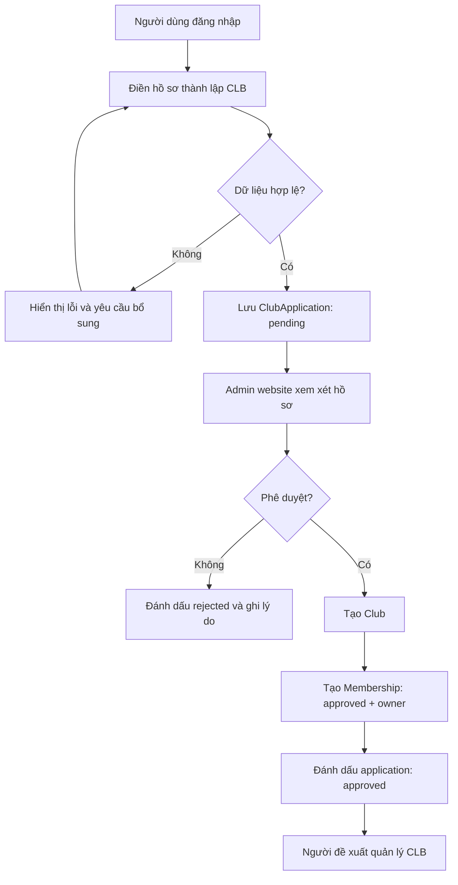

# Quy trình thành lập câu lạc bộ trên ClubHub

## 1. Vai trò

| Vai trò | Phạm vi quyền |
|---|---|
| Admin website | Quản trị toàn nền tảng, xét duyệt hồ sơ thành lập CLB |
| Chủ nhiệm (Membership.owner) | Toàn quyền quản lý một CLB cụ thể, thành viên và sự kiện của CLB |
| Điều phối viên (Membership.moderator) | Quản lý thành viên và hoạt động theo quy tắc quyền trong CLB |
| Thành viên (Membership.member) | Tham gia hoạt động và sự kiện |

`User.role` không được sử dụng để lưu vai trò Chủ nhiệm. Vai trò CLB nằm ở `Membership.role`; đây là hai phạm vi độc lập.

## 2. Bộ điều kiện hồ sơ

- Tên CLB: 3–100 ký tự, không trùng CLB đã được duyệt hoặc hồ sơ đang chờ.
- Danh mục hoạt động.
- Giới thiệu: ít nhất 100 ký tự.
- Sứ mệnh: ít nhất 50 ký tự.
- Đối tượng và quy mô thành viên: ít nhất 20 ký tự.
- Kế hoạch hoạt động định kỳ: ít nhất 120 ký tự.
- Kế hoạch học kỳ đầu: ít nhất 80 ký tự.
- Kế hoạch tổ chức nhân sự: ít nhất 80 ký tự; mô tả Ban chủ nhiệm, các ban và cơ chế phân công.
- Kế hoạch tài chính: ít nhất 80 ký tự; nêu ngân sách dự kiến, nguồn lực và nguyên tắc công khai thu chi.
- Danh sách sáng lập: 5–30 người; mỗi người có tên, nhiệm vụ và ít nhất email hoặc số điện thoại hợp lệ. Người gửi hồ sơ phải khớp với email/số điện thoại đã đăng nhập.
- Email liên hệ hợp lệ.
- Số điện thoại liên hệ chuẩn E.164.
- Địa điểm hoạt động.
- Cam kết tuân thủ các quy định.
- Cố vấn: tùy chọn.

Các ngưỡng ký tự là quy tắc nghiệp vụ mẫu do dự án đặt ra để chuẩn hóa hồ sơ; khi nhà trường có biểu mẫu riêng, cần thay theo quy định chính thức.

## 3. Luồng xử lý

## 4. Dữ liệu chính

- `ClubApplication`: lưu nội dung đề xuất và trạng thái xét duyệt.
- `Club`: chỉ được tạo khi hồ sơ được duyệt (endpoint tạo trực tiếp bị khóa).
- `Membership`: gắn người đề xuất làm Chủ nhiệm (`owner`) của CLB vừa tạo.
- `User`: người đề xuất giữ vai trò hệ thống bình thường (`member`). Admin website vẫn là tài khoản quản trị viên được cấu hình bởi người vận hành nền tảng.

## 5. Trạng thái hồ sơ

`pending` → chờ Admin xét duyệt; `processing` → đang được một Admin xử lý; `approved` → đã tạo CLB và Chủ nhiệm; `rejected` → từ chối, có thể ghi chú lý do.

API sử dụng cập nhật có điều kiện khi nhận xử lý để hạn chế hai Admin duyệt trùng một hồ sơ. Khi bước tạo CLB hoặc Membership gặp lỗi, backend thực hiện thao tác bù trừ và đưa hồ sơ về `pending`.

## 6. Quyền riêng tư của hồ sơ

Admin website có thể xem email/số điện thoại từng người sáng lập, kế hoạch ngân sách và email cố vấn trong hồ sơ xét duyệt. API danh sách/chi tiết CLB công khai chỉ trả tên và nhiệm vụ sáng lập viên; không trả thông tin liên hệ cá nhân, không công khai kế hoạch tài chính hoặc email cố vấn. Email và số điện thoại liên hệ chính thức của CLB là thông tin liên hệ chung.
